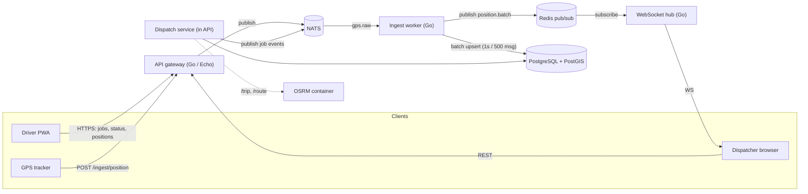

# 01 · FleetOps — Real-Time Fleet Tracking & Dispatch Platform

> **Pitch:** An operations platform for small/medium courier and field-service fleets: live vehicle tracking, job dispatch, geofencing, alerting, and driver tools in one system.
> **Stack:** Go (Echo) · NATS · PostgreSQL + PostGIS · Redis · React + MapLibre · OSRM · Docker Compose
> **CV framing:** high-throughput geospatial telemetry, batch ingestion under backpressure, WebSocket fanout, offline-tolerant driver PWA.

---

## 1. Problem & users

A regional courier company with 100–500 vans runs dispatch on three disconnected tools: a GPS vendor portal (positions only), WhatsApp (job coordination), and a spreadsheet (planning). Dispatchers can't see which driver is closest to a pickup; managers can't answer "why was yesterday's on-time rate 71%?"; drivers juggle phone calls while driving.

**Users and what they need:**

| User | Needs |
|---|---|
| Dispatcher | Live map of all vehicles, create/assign jobs in seconds, alerts when things go wrong |
| Fleet manager | Daily operations reports, vehicle/driver registry, exportable history |
| Driver | Simple mobile web app: today's jobs, one-tap status changes, works with bad signal |
| Admin | User management, device pairing, API keys, fleet settings |

## 2. Scope

### 2.1 MVP (must-have)

1. **Fleet registry** — vehicles (plate, model, paired device ID, status), drivers (name, license no., phone, shift), vehicle↔driver↔device pairing with history.
2. **Auth & roles** — JWT login; roles: admin, dispatcher, manager, driver (see §8).
3. **Live tracking** — driver PWA and GPS trackers POST positions (`lat`, `lng`, `speed`, `heading`, `accuracy`, `ts`); system stores latest position + append-only history.
4. **Operations map** — MapLibre GL: vehicle markers colored by status (idle / en route / offline), clustering at low zoom, click-for-details card, "follow vehicle" mode; markers gray out after 2 minutes without updates.
5. **Job lifecycle** — dispatcher creates job (pickup, dropoff, time window, notes, size/weight); states: `created → assigned → accepted → en_route → picked_up → delivered` (+ `failed`, `cancelled`); driver advances state in the PWA; photo proof + coordinates captured at delivery.
6. **Geofences** — dispatcher draws polygons/circles on the map (depots, customer zones); system raises `enter` / `exit` / `dwell > N min` events per vehicle.
7. **Alerts** — configurable rules: device silent > 10 min, geofence exit outside schedule, ETA slip > 15 min; delivered to in-app notification bell (email stub OK).
8. **Reports** — per-day/per-driver: jobs completed, on-time %, distance driven, idle time; CSV export.

### 2.2 Version 2 (stretch)

- Multi-stop route optimization via OSRM `/trip` with manual drag-to-reorder.
- Public "track my delivery" link (signed token, expiring, map-only).
- Driver scoring (on-time %, harsh-braking proxy from speed deltas).
- Fuel/odometer logs; maintenance reminders.
- Webhooks out (job events → customer systems); i18n (dispatch UI).

### 2.3 Explicitly out of scope

Payroll, customs/international compliance, native mobile apps, customer-facing booking, pricing/invoicing.

## 3. Architecture



**Position flow (the hot path):** device POSTs → gateway validates + publishes to NATS `gps.raw` (fire-and-forget; HTTP returns 204 immediately) → ingest worker consumes, buffers up to 1s or 500 messages, then batch-upserts `vehicles_latest` (one row per vehicle, `INSERT ... ON CONFLICT DO UPDATE` via `UNNEST`) and appends to the monthly `positions_*` partition → publishes `position.batch` to Redis → WS hub fans out to dispatcher rooms keyed by `fleet_id`.

**Job flow:** dispatcher POSTs job → API persists (`state=created`) → dispatcher assigns → API writes `assigned`, publishes `jobs.events` → driver PWA (polling fallback + push when online) accepts and advances states → delivery photo goes to MinIO, coordinates recorded → every transition is an append-only row in `job_events` (audit + replayable).

**Why this shape:** HTTP ingestion keeps devices dumb and firewall-friendly; NATS decouples ingest rate from write rate; the `vehicles_latest` + partitioned history split keeps the map read cheap while retaining analytics data.

## 4. Tech stack & rationale

| Layer | Choice | Why | Rejected alternatives |
|---|---|---|---|
| API / ingest / WS hub | Go + Echo | Goroutines fit per-connection fanout; single-binary deploys; strong `time`/`context` tooling for batching | Node (fine, but Go holds 10k WS conns more predictably); Java Spring (heavier than needed) |
| Message backbone | NATS | Lightweight pub/sub, subject wildcards, optional JetStream; runs in one container | Kafka (operational overkill at this scale); Redis Streams (workable; NATS subjects map better to fleet topics) |
| OLTP + spatial | PostgreSQL + PostGIS | GIST-indexed geometry, `ST_Contains`/`ST_DWithin`, mature partitioning | MongoDB geo (weaker query expressiveness); Elasticsearch (search engine, not source of truth) |
| Fanout / presence | Redis | Pub/sub for position batches, TTL keys for online presence | NATS-only (viable; Redis is simpler for room semantics) |
| Frontend | React 18 + Vite + MapLibre GL + TanStack Query | Largest map ecosystem; Query handles polling/revalidation cleanly | Leaflet (struggles with thousands of animated markers) |
| Routing | OSRM (self-hosted, small region extract) | Free, no API key, containerized; `/route` + `/trip` | Google Directions (cost + ToS on storing results) |
| Driver app | React PWA (same codebase, separate build) | One language, installable, offline via service worker + IndexedDB queue | React Native (extra toolchain for zero MVP benefit) |

## 5. Data model

Core tables (PostgreSQL):

- `fleets(id, name)` — multi-tenant root; every table carries `fleet_id`.
- `vehicles(id, fleet_id, plate, model, status, paired_device_id)`
- `drivers(id, fleet_id, name, license_no_hash, phone, shift_start, shift_end)`
- `devices(id, fleet_id, kind [pwa|tracker], api_key_hash, last_seen_at)`
- `jobs`, `job_events(id, job_id, from_state, to_state, actor_id, at)` — append-only.
- `geofences(id, fleet_id, name, kind [polygon|circle], geom geography, schedule jsonb)`
- `alerts(id, fleet_id, kind, severity, payload jsonb, raised_at, acked_by)`
- `vehicles_latest` — one row per vehicle, hot-read for the map.
- `positions_YYYY_MM` — monthly partitions, append-only, 12-month retention.

```sql
CREATE TABLE vehicles_latest (
  vehicle_id   BIGINT PRIMARY KEY REFERENCES vehicles(id),
  fleet_id     BIGINT NOT NULL,
  geom         geography(Point, 4326) NOT NULL,
  speed_kmh    REAL,
  heading_deg  REAL,
  device_ts    TIMESTAMPTZ NOT NULL,
  server_ts    TIMESTAMPTZ NOT NULL DEFAULT now()
);
CREATE INDEX vehicles_latest_geom_gix ON vehicles_latest USING GIST (geom);
CREATE INDEX vehicles_latest_fleet_idx ON vehicles_latest (fleet_id);

CREATE TABLE jobs (
  id           BIGSERIAL PRIMARY KEY,
  fleet_id     BIGINT NOT NULL,
  state        TEXT NOT NULL DEFAULT 'created',
  vehicle_id   BIGINT,
  driver_id    BIGINT,
  pickup       geography(Point, 4326) NOT NULL,
  dropoff      geography(Point, 4326) NOT NULL,
  window_start TIMESTAMPTZ,
  window_end   TIMESTAMPTZ,
  eta_minutes  INT,
  proof_photo  TEXT,
  created_at   TIMESTAMPTZ NOT NULL DEFAULT now(),
  delivered_at TIMESTAMPTZ
);
CREATE INDEX jobs_fleet_state_idx ON jobs (fleet_id, state);
```

State machine guard: transitions allowed only per the table in §2.1; enforced in the service layer plus a `BEFORE UPDATE` trigger that appends to `job_events`.

## 6. API surface

REST (JSON, JWT unless noted):

| Method | Path | Purpose |
|---|---|---|
| POST | `/auth/login` | issue JWT (email+password) |
| GET/POST/PATCH | `/vehicles`, `/drivers` | registry CRUD, pairing |
| POST | `/ingest/position` | device position (device API-key auth; 204) |
| GET | `/map/vehicles?bbox=...` | latest positions within bbox (map init) |
| GET/POST | `/jobs` | list (filters: state, driver, day), create |
| POST | `/jobs/:id/assign` | assign vehicle+driver |
| POST | `/driver/jobs/:id/accept` / `/start` / `/pickup` / `/deliver` | driver transitions (multipart for proof photo) |
| GET | `/driver/jobs/today` | driver's own jobs (works from cached snapshot offline) |
| GET/POST/DELETE | `/geofences` | CRUD (GeoJSON in/out) |
| GET | `/alerts?since=` | list; PATCH `/alerts/:id/ack` |
| GET | `/reports/daily?date=&driver=` | JSON; `?format=csv` export |
| WS | `/stream?fleet=<id>` | server push (below) |

WebSocket events (JSON): `position.batch` (≤200 points, coalesced), `job.updated`, `alert.raised`, `presence.changed`.

## 7. Real-time & async design

NATS subjects:

| Subject | Producer | Consumer | Notes |
|---|---|---|---|
| `gps.raw.<fleet_id>` | gateway | ingest worker | fire-and-forget; stale (>60s old) dropped under load |
| `positions.batch.<fleet_id>` | ingest worker | WS hub | ≤200 points per message |
| `jobs.events.<fleet_id>` | API | WS hub, V2 webhook relay | state transitions |
| `alerts.<fleet_id>` | alert evaluator | WS hub | |

Key mechanics: ingest buffers with a 1 s / 500-message flush; batch upsert via `UNNEST` (one statement per flush, no row locks held per message); presence = Redis `SET device:<id> online EX 120` refreshed per message; geofence evaluation does a bounding-box prefilter (`ST_DWithin` with fence radius) before exact `ST_Contains`, debounced to 30 s per vehicle-fence pair; WS hub caps rooms at 2,000 connections and evicts on missed pong.

## 8. Security & roles

| Resource | Admin | Manager | Dispatcher | Driver |
|---|---|---|---|---|
| Vehicles/drivers CRUD | ✅ | ✅ | create/read | own profile |
| Jobs create/assign | ✅ | read | ✅ | own jobs, state transitions only |
| Geofences | ✅ | read | ✅ | — |
| Reports | ✅ | ✅ | own fleet | own stats |
| Device API keys | ✅ | — | — | — |

- JWT (15 min) + refresh token; `fleet_id` claim enforced in every query (row scoping).
- Devices authenticate with per-device API keys (stored hashed, rotatable, revocable).
- Driver license numbers stored as hashes; photo proofs in MinIO behind signed URLs (15 min).
- Audit: `job_events` + `alerts` are append-only; admin actions logged with actor.

## 9. Non-functional requirements

| Concern | Target |
|---|---|
| Ingest load | 500 vehicles × 1 msg/5 s = 100 msg/s steady, 2,000 msg/s burst (simulator: 10×) |
| End-to-end freshness | p95 position on map ≤ 2 s after device send |
| API latency | p95 ≤ 300 ms for assignment/report endpoints |
| Observability | Prometheus metrics (ingest rate, flush sizes, WS conns, geofence eval latency), Grafana dashboard, OpenTelemetry traces on the assign flow |
| Testing | Go unit tests; testcontainers integration (PostGIS, NATS, Redis); k6 WS/HTTP load script; Playwright happy-path (create→assign→deliver) |

## 10. Build plan

- [ ] **Phase 0 — scaffold (day 1–2):** monorepo layout, docker-compose (postgres+postgis, redis, nats, osrm, minio), CI (fmt+lint+test), golang-migrate setup.
- [ ] **Phase 1 — foundation:** auth + roles, fleet/vehicle/driver/device registry, pairing, seed script.
- [ ] **Phase 2 — telemetry core:** `/ingest/position`, NATS wiring, batching ingest worker, `vehicles_latest`, WS hub, map with live markers, **GPS simulator** (`tools/simulator --fleet=50 --rate=5s`).
- [ ] **Phase 3 — jobs:** job CRUD + state machine + audit events, assignment UI, driver PWA (offline IndexedDB queue, photo upload to MinIO).
- [ ] **Phase 4 — geofences & alerts:** polygon drawing UI, geofence evaluator, alert rules + bell + email stub, daily reports + CSV.
- [ ] **Phase 5 — harden & demo:** k6 load test at 10× target, tune batching/flush, Grafana dashboards, demo dataset + 5-minute demo script (create job → watch van move → deliver with photo → alert fires → report), README polish.

**Demo script (for the CV/portfolio video):** log in as dispatcher → watch 50 simulated vans on the map → draw a depot geofence → create + assign a job to the nearest van → driver PWA accepts and advances → delivery photo appears → "device silent" alert fires → open daily report.

## 11. Suggested repository layout

```
fleetops/
├── apps/
│   ├── web/               # dispatcher UI (React + Vite)
│   └── driver-pwa/        # driver app (React PWA)
├── services/
│   ├── api/               # Echo REST + dispatch service
│   ├── ingest/            # NATS consumer + batch writer
│   └── ws-hub/            # WebSocket fanout
├── packages/
│   └── shared-types/      # OpenAPI-generated TS types
├── tools/
│   └── simulator/         # GPS/job traffic generator (Go)
├── deploy/
│   ├── docker-compose.yml
│   └── grafana/           # dashboards as code
└── docs/                  # ADRs, API notes
```

## 12. Local development

| Service | Image | Port |
|---|---|---|
| PostgreSQL + PostGIS | `postgis/postgis:16` | 5432 |
| Redis | `redis:7` | 6379 |
| NATS | `nats:2` | 4222 |
| OSRM | `osrm/osrm-backend` (small region extract) | 5000 |
| MinIO | `minio/minio` | 9000/9001 |
| API / ingest / ws-hub | local Go | 8080 / — / 8090 |
| Web / driver PWA | Vite dev | 5173 / 5174 |

Env: `DATABASE_URL`, `NATS_URL`, `REDIS_URL`, `OSRM_URL`, `MINIO_ENDPOINT/KEY/SECRET`, `JWT_SECRET`, `DEVICE_KEY_SALT`.
First run: `docker compose up -d` → `make migrate seed` → `go run ./tools/simulator` → open dispatcher UI.

## 13. Risks & pitfalls

- **Unbounded position history** → monthly partitions + retention job from day one, not "later".
- **WS hub memory growth** → room caps, ping/pong eviction, no per-connection goroutine leaks (test with `go test -race` + 10k synthetic conns).
- **Geofence evaluation cost** → bounding-box prefilter + debounce; exact geometry only on candidates.
- **OSRM RAM** — use a city/region extract (~200–500 MB), not a continent.
- **GPS jitter** — filter by `accuracy > 50 m`, smooth heading, consider snap-to-road as V2.
- **Clock skew on devices** — store both `device_ts` and `server_ts`; order by `server_ts`.

## 14. Interview talking points

- Why batch upserts beat per-message inserts (WAL amplification, index churn, lock contention) — and how you measured it.
- NATS vs Kafka at this scale: delivery guarantees you actually need (at-least-once + idempotent upserts) vs operational cost.
- PostGIS vs Redis geohash for "vehicles near X": correctness vs latency tradeoffs.
- How you'd shard by fleet at 50k vehicles (per-fleet ingest workers, WS room routing).
- Exactly-once is a lie: idempotency keys on job transitions and how the audit log makes replays safe.

## 15. Cloud deployment profile (free tier)

**Frontend:** Cloudflare Pages (React) · **Backend:** Render container (api + ws-hub + ingest merged into one container profile; embedded single-node NATS) · **Data:** Neon (Postgres + PostGIS) · **Email/cron:** n/a / Val Town cron

| Local (docker-compose) | Cloud (free tier) |
|---|---|
| PostgreSQL + PostGIS | Neon — `CREATE EXTENSION postgis` (supported) |
| NATS + separate ws-hub | embedded NATS in the Render container; in-process WS hub (single-instance note) |
| Redis pub/sub | in-process channels (single node) — Redis stays local for load tests |
| OSRM container | public demo server `router.project-osrm.org` (rate-limited, demo only) |
| React dispatcher UI | Cloudflare Pages (Vite static build, `/stream` proxied to Render) |

Deploy: 1) push to GitHub, Actions CI builds the Go image → Render. 2) Neon: migrate + enable PostGIS; set `DATABASE_URL`, `JWT_SECRET` via env. 3) verify live URL: login, map loads, simulator (run locally) streams positions to the cloud ingest endpoint. 4) demo-on-demand — Render free spins down when idle (cold start ~1 min).
Honest notes: hosted demo targets ~50 vehicles; the 2,000 msg/s burst profile stays a local k6 exercise.
